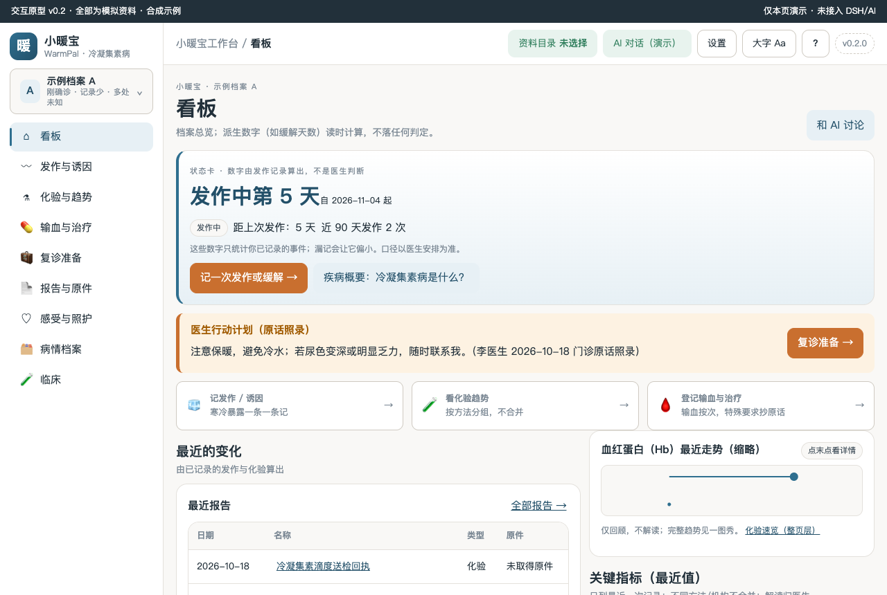
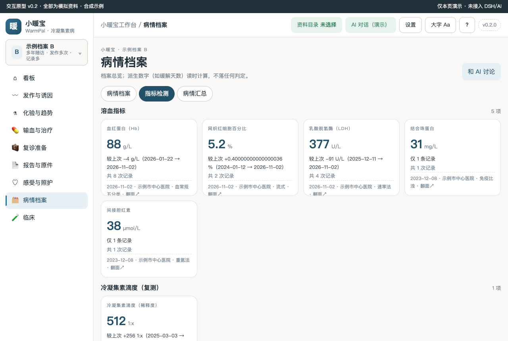
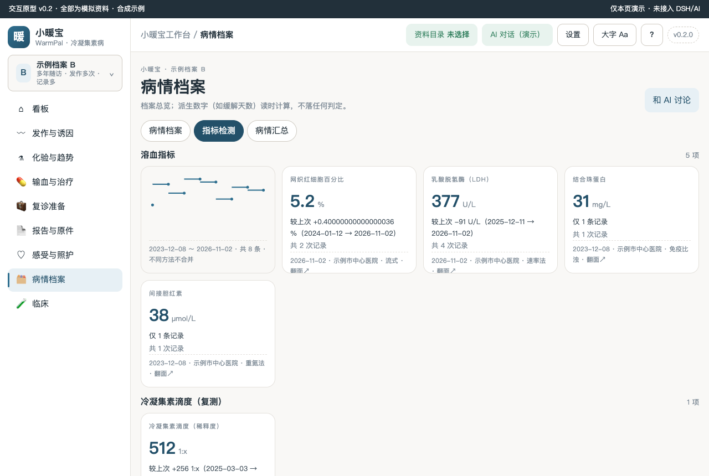
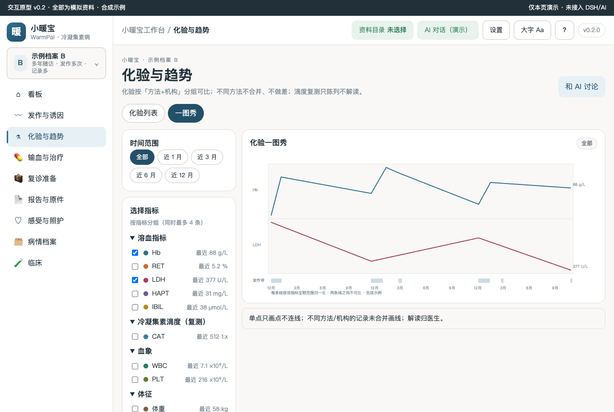
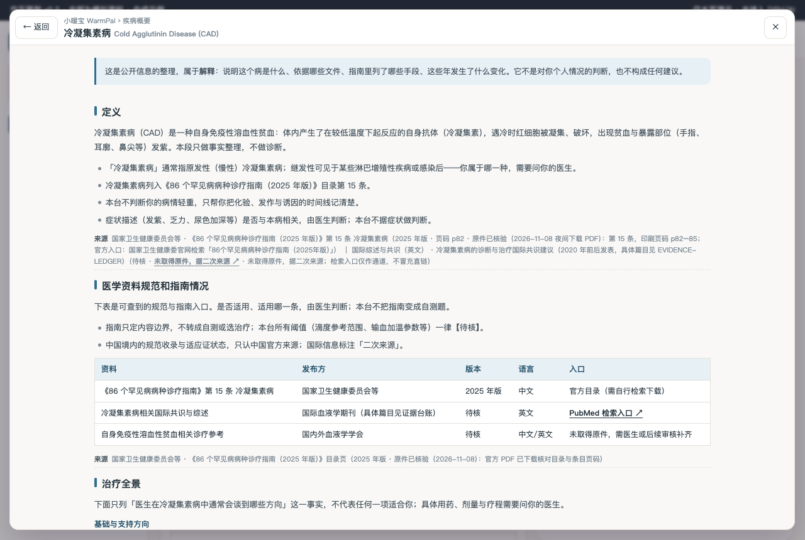

# 小暖宝 WarmPal · 冷凝集素病（CAD）工作台

本机优先的患者工作台：把散落各医院的溶血化验、冷凝集素滴度复测、寒冷诱发发作、输血记录与医生原话，整理成一本「来源可追溯、不替医生下结论」的病程档案。

> 状态：交互原型 v0.2（夜间无人值守开发 · 全部闸口为自动签认，待晨审追认）。0 患者访谈、0 临床审核，界面全部使用合成示例数据。

## 疾病概要

冷凝集素病（CAD）是一种罕见的自身免疫性溶血性贫血：冷反应性自身抗体在较低温度下使红细胞凝集、破坏，表现为贫血与暴露部位（手指、耳廓等）发紫，寒冷加重。列入《86 个罕见病病种诊疗指南（2025 年版）》第 15 条（原件已核验，p82–85）。顶栏「?」与首页按钮可打开四段整页疾病概要（定义 / 医学资料规范和指南情况 / 治疗全景 / 发展趋势），每段带来源行。

## 关键功能（截图墙）

看板：状态卡「发作中第 N 天 / 缓解期第 N 天」由你记录的发作算出，附医生行动计划原话与 Hb 走势缩略图。

指标检测：溶血指标 / 冷凝集素滴度 / 血象 / 体征 四组 3D 翻转卡，正面最近值与「较上次」差值（不写疗效结论）。

翻面看近期走势缩略图；不同方法/机构不合并、不做差。

一图秀：每条序列独立等高归一化（标注「不可比」）、末点数值标签、时间窗联动、私密记录不进图。

疾病概要：整页面板四段，固定出口「按受累器官与病情轻重排列 · 不代表任何一项适合你 · 需要问你的医生」。

## 怎么用

- `prototypes/v0.2/index.html` 直接双击打开（独立演示态），或经 DSH Desktop 宿主加载（开发版见 M5 后说明）。
- 侧栏可切换示例档案 A（刚确诊、记录少、多处未知）/ B（多年随访、发作与指标多）；切换整页联动。
- 顶栏：资料目录 / AI 对话（演示，只填草稿不发送）/ 设置（三 tab：工作区、文档解析 MinerU、临床数据库）/ 大字 / ?（疾病概要）。

## 数据与口径

- 全部数据为两组合成示例（demo-data.js 唯一源），不冒充真实病历；页面不写死数字。
- 「仅回顾，不解读」「不同方法/机构不合并」「解读归医生」；所有医学阈值一律【待核】。
- 私密记录三出口过滤（看板摘要 / 导出 / AI 上下文），页内标注「N 条中私密 M 条」。
- 临床试验线已如实裁剪（理由见 docs/DEV-REQUIREMENTS §三），设置·临床数据库 tab 有同口径声明。

## 开发

- 结构移植自家族同形仓（pericarditis-workbench），语义逐项重写；探针：`node scripts/probe-cold-agglutinin-m2.mjs`（34/34）、`node scripts/probe-disease-primer.mjs --url http://127.0.0.1:<port>/prototypes/v0.2/index.html`（10/10）、`node scripts/probe-page-view.mjs --url …`（13/13）。
- 门禁：`npm run check`（staticPass=true）、`npm test`。
- 文档：docs/SPEC、DEV-REQUIREMENTS、DIFF-MATRIX、EVIDENCE-LEDGER、CLINICAL-DATA、signoffs/（G1/G2 自动签认）。
